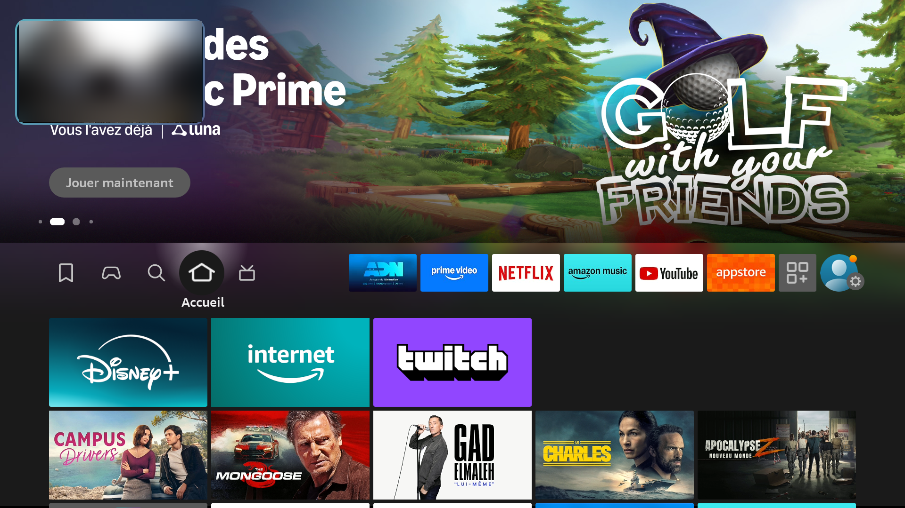
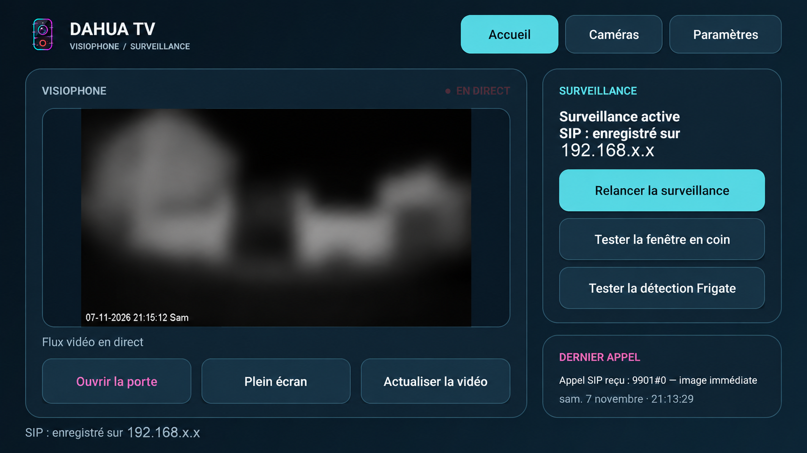
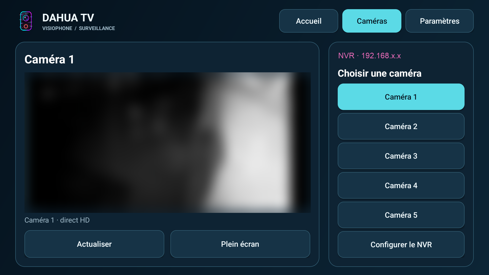

# Installer et configurer Dahua TV

Ce guide accompagne la première installation sur Android TV ou Fire TV Stick, puis le réglage du visiophone et des caméras. Prévoyez la télécommande, une connexion au même réseau local que le portier et le NVR, ainsi que les paramètres de votre propre installation Dahua.

[Retour à l'accueil](README.md) · [Télécharger `DahuaTV.apk`](https://github.com/crashcool69/Dahua-TV/releases/latest/download/DahuaTV.apk) · [Compatibilité](COMPATIBILITE.md)

## 1. Avant de commencer

- Vérifiez que l'appareil fonctionne sous Android TV ou sous Fire OS compatible avec les APK. Le Fire TV Stick AFTSS sous Fire OS 7.6.5.2 et la TCL Smart TV Pro sous Android TV 12 ont été testés.
- Gardez à portée de main l'adresse locale du VTO ou du serveur SIP, le compte SIP et son mot de passe, puis l'adresse RTSP et les identifiants vidéo. Pour le NVR, préparez son adresse, son port RTSP, un compte autorisé et les numéros des canaux.
- Téléchargez uniquement l'APK publié dans la [dernière release du dépôt](https://github.com/crashcool69/Dahua-TV/releases/latest). Le fichier attendu se nomme **`DahuaTV.apk`**.

## 2. Installer sur Android TV

Les libellés varient selon le constructeur et la version d'Android TV.

1. Sur la TV, installez depuis le Play Store une application capable de télécharger ou d'ouvrir l'APK, par exemple Downloader, ou utilisez un gestionnaire de fichiers si vous avez copié l'APK sur une clé USB.
2. Ouvrez **Paramètres > Applications > Accès spécial aux applications > Installer des applications inconnues**. Sur certains appareils, le chemin passe par **Sécurité et restrictions > Sources inconnues**. Autorisez **l'application qui ouvrira l'APK** : Downloader, le navigateur ou le gestionnaire de fichiers choisi. L'autorisation s'applique à cette application, pas à Dahua TV.
3. Dans Downloader ou le navigateur de la TV, ouvrez `https://github.com/crashcool69/Dahua-TV/releases/latest/download/DahuaTV.apk`. Si vous utilisez une clé USB, ouvrez le fichier `DahuaTV.apk` depuis le gestionnaire de fichiers autorisé.
4. Une fois le téléchargement terminé, choisissez **Installer**, puis **Ouvrir**. Si Android bloque l'installation, revenez à l'étape 2 et vérifiez l'autorisation de l'application qui a lancé l'installation.
5. Retrouvez ensuite **Dahua TV** dans les applications de la TV. Si une autorisation de notification est proposée, accordez-la pour recevoir les alertes lorsque la fenêtre ne peut pas s'afficher.

## 3. Installer sur Fire TV Stick

1. Dans l'**Appstore Amazon**, recherchez **Downloader** et installez-le.
2. Ouvrez **Paramètres > Ma Fire TV > Options pour les développeurs > Installer des applications inconnues**, puis autorisez **Downloader**. Selon la version de Fire OS, l'entrée peut se trouver dans **Applications** ou s'appeler **Applications de sources inconnues**. Si **Options pour les développeurs** n'apparaît pas, ouvrez **Ma Fire TV > À propos**, sélectionnez le nom de l'appareil plusieurs fois, puis revenez à l'écran précédent.
3. Ouvrez Downloader et saisissez le code **5492774**. Vérifiez que la page obtenue mène bien au fichier `DahuaTV.apk` de la [dernière release de ce dépôt](https://github.com/crashcool69/Dahua-TV/releases/latest/download/DahuaTV.apk).
4. Sélectionnez **Télécharger**, puis **Installer** quand Fire TV le propose. Ouvrez Dahua TV depuis la bibliothèque d'applications.

L'adresse directe est `https://github.com/crashcool69/Dahua-TV/releases/latest/download/DahuaTV.apk`. Si le code Downloader ne donne pas le bon fichier, saisissez cette adresse directement. Fire OS doit être une version qui accepte les APK Android ; un appareil sous Vega OS ne convient pas.

Après la configuration, voici la fenêtre réelle d'un appel sur le Fire TV Stick testé ; la vue du portier est floutée.



## 4. Renseigner le portier : SIP, VTO et VTH

Ouvrez **Dahua TV > Paramètres > Connexion SIP**. Le **VTO** est le portier extérieur ; le **VTH** est le moniteur intérieur. Dahua TV utilise un compte SIP adapté à cette installation pour repérer les appels. Relevez les valeurs dans la configuration de votre équipement : ne copiez pas l'adresse ou le compte d'une autre installation.

| Champ | Valeur à saisir |
| --- | --- |
| Serveur | Adresse locale du serveur SIP ou du VTO selon votre installation. |
| Port | Port SIP configuré sur l'équipement ; `5060` est courant pour SIP/UDP. |
| Domaine | Domaine SIP déclaré par l'installation Dahua. |
| Compte | Compte SIP attribué à Dahua TV ; utilisez un compte distinct si votre équipement le permet. |
| Mot de passe SIP | Mot de passe de ce compte, saisi directement sur la TV. |

Sélectionnez **Enregistrer et relancer**. L'état attendu est **« SIP : enregistré sur … »**. Faites ensuite sonner le VTO et vérifiez que l'appel apparaît sur la TV. Un VTH ou un autre client SIP utilisant le même compte peut capter l'appel à la place de Dahua TV : si cela arrive, vérifiez les comptes et les limites de sessions de votre portier.

## 5. Renseigner la vidéo RTSP du VTO

Dans **Paramètres > Flux du portier**, renseignez l'adresse RTSP et les identifiants vidéo. Le bouton **Préparer l'adresse Dahua** construit une adresse du type :

```text
rtsp://ADRESSE_DU_VTO:554/cam/realmonitor?channel=1&subtype=0
```

Remplacez l'adresse et, si nécessaire, le port, le canal ou le sous-flux suivant la configuration de votre VTO. Le compte vidéo peut être différent du compte SIP. Saisissez **Utilisateur vidéo** et **Mot de passe vidéo**, puis choisissez **Enregistrer et relancer**. Revenez à l'accueil et ouvrez le direct du portier pour contrôler l'image. Si elle reste noire, vérifiez d'abord l'adresse, les identifiants, le réseau local et le nombre de sessions RTSP déjà utilisées.



## 6. Autoriser et régler la fenêtre d'appel

Dans **Paramètres > Fenêtre pendant un appel**, cochez **Afficher la vidéo en coin si la TV l'autorise**. Choisissez ensuite **Autoriser la fenêtre** et accordez à Dahua TV l'affichage par-dessus les autres applications dans les réglages du système. Revenez dans Dahua TV, appuyez sur **Tester la fenêtre**, puis faites un vrai appel depuis le VTO.

Sur certains firmwares, l'autorisation affichée comme active ne suffit pas : la fenêtre peut rester bloquée par le système. Dans ce cas, l'alerte peut prendre la forme d'une notification et l'ouverture du direct reste possible depuis Dahua TV. Sur Fire TV, les notifications des applications tierces peuvent être peu visibles ; le test par appel réel reste le plus utile.

## 7. Configurer le NVR et les caméras

Ouvrez **Caméras > Configurer le NVR**. Renseignez l'adresse IP locale du NVR, le port RTSP (souvent `554`), un utilisateur autorisé à lire les caméras et son mot de passe. Saisissez les **cinq numéros de canaux distincts**, séparés par des virgules, puis choisissez **Enregistrer**. Revenez dans **Caméras** et ouvrez chaque canal utile.

Le flux Dahua habituel a la forme `rtsp://ADRESSE_DU_NVR:554/cam/realmonitor?channel=1&subtype=0` ; l'application utilise les identifiants saisis sur la TV. Si votre installation Frigate lit déjà ces canaux du NVR, reprenez les **mêmes numéros de canaux et le même profil RTSP**. Cette configuration ne nécessite pas de publier vos identifiants Frigate. Une connexion directe à l'API Frigate ou des alertes de détection ne sont pas établies par les éléments vérifiés pour ce guide : vérifiez ces fonctions dans votre version avant de les activer.



La grille de **quatre caméras** et le NVR ont été confirmés sur le Fire TV Stick testé. Si plusieurs flux chargent lentement sur un autre appareil, essayez d'abord une caméra à la fois et vérifiez les limites de décodage et les profils vidéo du NVR.

## 8. Audio et ouverture de porte

Pour le son, vérifiez le volume de la TV et la piste audio du flux vidéo de votre portier. Le bouton **Tester le micro**, lorsqu'il est présent, vérifie seulement qu'une entrée audio est accessible à l'application : il ne constitue pas un test d'interphonie. La possibilité d'entendre le visiteur ou de lui parler dépend de la version, du flux et du matériel. Ne présumez pas qu'une conversation bidirectionnelle fonctionne avant un essai réel.

Si votre installation propose **Ouvrir la porte**, configurez les identifiants vidéo nécessaires sur la TV et testez cette commande devant le portail. Ne publiez jamais ces identifiants dans un rapport ou une capture.

## 9. Mettre à jour et résoudre les problèmes courants

Pour une mise à jour, ouvrez de nouveau le [lien de la dernière release](https://github.com/crashcool69/Dahua-TV/releases/latest/download/DahuaTV.apk), ou reprenez le code Downloader **5492774** sur Fire TV. Installez le nouvel APK par-dessus la version existante. Ne désinstallez pas l'application si vous souhaitez conserver ses réglages ; une mise à jour conserve normalement les données lorsque la signature de l'APK reste identique.

| Symptôme | Vérification utile |
| --- | --- |
| Installation refusée | Autorisez les sources inconnues pour Downloader, le navigateur ou le gestionnaire de fichiers qui ouvre l'APK. |
| Pas d'enregistrement SIP | Vérifiez serveur, port, domaine, compte, mot de passe et connexion au réseau local. |
| Appel absent sur la TV | Vérifiez qu'un VTH, un autre client ou un second appareil n'utilise pas le même compte SIP. |
| Vidéo noire | Vérifiez l'URL RTSP, les identifiants vidéo, le canal et la limite de sessions du VTO ou du NVR. |
| Fenêtre absente | Accordez la superposition à Dahua TV, puis utilisez **Tester la fenêtre** et un appel réel. |
| Grille saccadée | Essayez un seul canal et un profil vidéo moins exigeant sur le NVR. |

Les essais détaillés et les limites de compatibilité figurent dans [COMPATIBILITE.md](COMPATIBILITE.md). Toutes les illustrations de ce guide sont des captures réelles déjà floutées ; elles ne montrent aucune donnée privée lisible.
