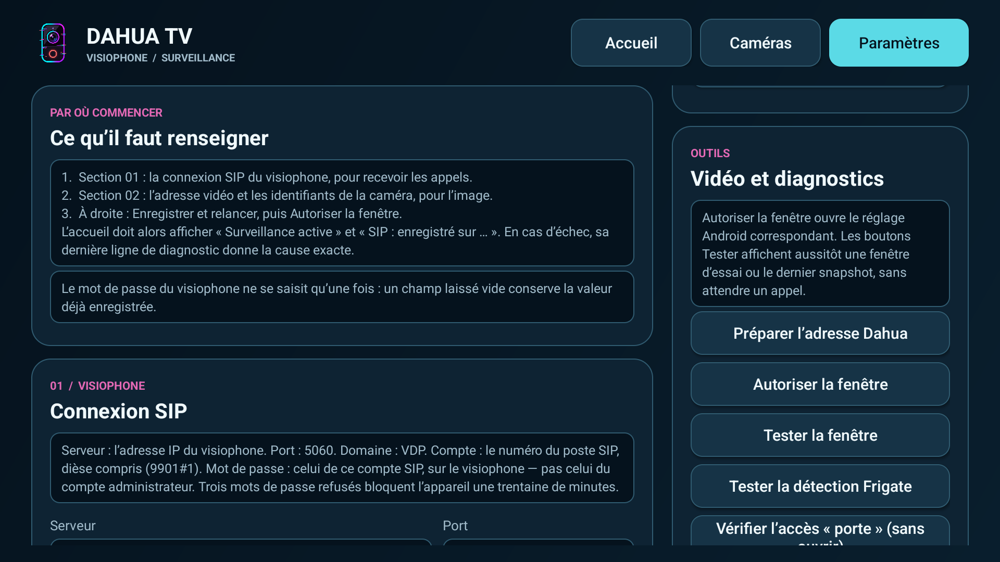
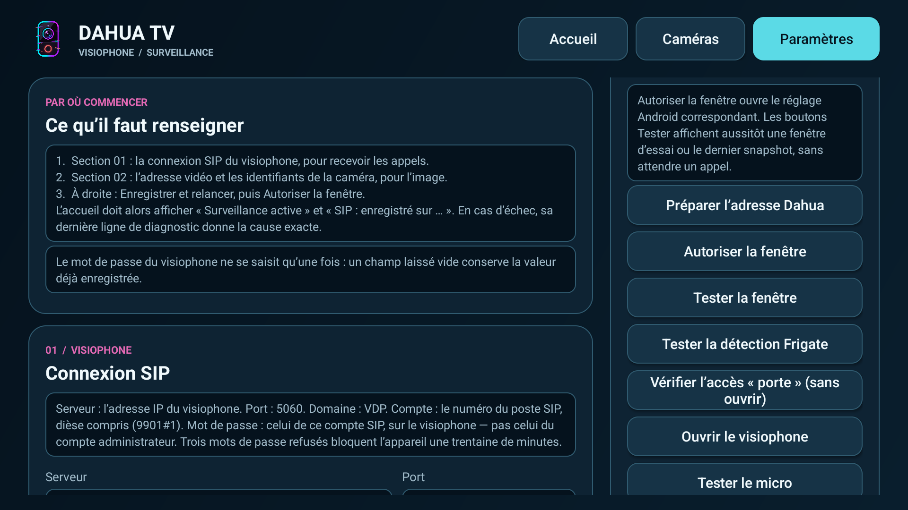
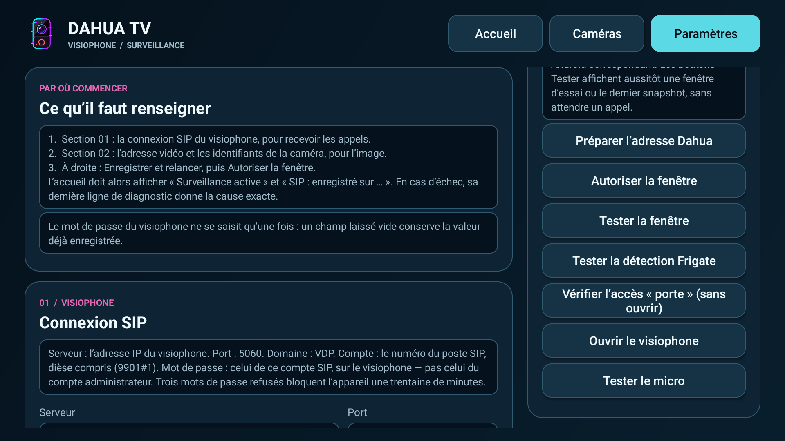

<p align="center"></p>

# Installer et configurer Dahua TV

Ce guide accompagne la première installation sur Android TV ou Fire TV Stick, puis le réglage du visiophone et des caméras. Prévoyez la télécommande, une connexion au même réseau local que le visiophone et le NVR, ainsi que les paramètres de votre propre installation Dahua.

[Retour à l'accueil](README.md) · [Télécharger `DahuaTV.apk`](https://github.com/crashcool69/Dahua-TV/releases/latest/download/DahuaTV.apk) · [Compatibilité](COMPATIBILITE.md)

## 1. Avant de commencer

- Vérifiez que l'appareil fonctionne sous Android TV ou sous Fire OS compatible avec les APK. Le Fire TV Stick AFTSS sous Fire OS 7.6.5.2 et la TCL Smart TV Pro sous Android TV 12 ont été testés.
- Gardez à portée de main l'adresse locale du VTO ou du serveur SIP, le compte SIP et son mot de passe, puis l'adresse RTSP et les identifiants vidéo. Pour le NVR, préparez son adresse, son port RTSP, un compte autorisé et les numéros des canaux.
- Téléchargez uniquement l'APK publié dans la [dernière release du dépôt](https://github.com/crashcool69/Dahua-TV/releases/latest). Le fichier attendu se nomme **`DahuaTV.apk`**.

## 2. Installer sur Android TV avec Downloader

**Downloader** est disponible sur Android TV également. Voici son icône officielle, orange avec un « D » blanc et une flèche, pour le reconnaître dans le Play Store. Son éditeur est **AFTVnews**.


[Fiche officielle de Downloader sur Google Play](https://play.google.com/store/apps/details?id=com.esaba.downloader)

Les libellés des paramètres varient selon le constructeur et la version d'Android TV.

1. Sur la TV, ouvrez le **Play Store**, recherchez **Downloader** et installez l'application d'AFTVnews, reconnaissable à l'icône ci-dessus.
2. Ouvrez **Paramètres > Applications > Accès spécial aux applications > Installer des applications inconnues**. Sur certains appareils, le chemin passe par **Sécurité et restrictions > Sources inconnues**. Autorisez **Downloader**. L'autorisation s'applique à l'application qui ouvre l'APK, pas à Dahua TV.
3. Lancez Downloader et sélectionnez son champ de saisie. Entrez le **code 5492774** avec la télécommande, puis choisissez **Go / Aller**. Le code doit mener à **`DahuaTV.apk`** dans la dernière release de `crashcool69/Dahua-TV`. Vérifiez le nom du fichier et le dépôt avant de poursuivre.

   ```text
   5492774
   ```
4. Une fois le téléchargement terminé, choisissez **Installer**, puis **Ouvrir**. Si Android bloque l'installation, revenez à l'étape 2 et vérifiez l'autorisation de l'application qui a lancé l'installation.
5. Retrouvez ensuite **Dahua TV** dans les applications de la TV. Si une autorisation de notification est proposée, accordez-la pour recevoir les alertes lorsque la fenêtre ne peut pas s'afficher.

Si le code ne mène pas au bon fichier, saisissez directement dans Downloader l'adresse `https://github.com/crashcool69/Dahua-TV/releases/latest/download/DahuaTV.apk`. Vous pouvez aussi copier cet APK sur une clé USB et l'ouvrir avec un gestionnaire de fichiers. Autorisez alors **ce gestionnaire** dans les paramètres de sources inconnues. La capture ci-dessous montre Dahua TV **après installation et configuration** sur Android TV. Les zones privées sont floutées.


## 3. Installer sur Fire TV Stick avec Downloader

Il s'agit de la **même application Downloader** que dans la section Android TV : cherchez son icône orange affichée plus haut et l'éditeur **AFTVnews**. Comptez quelques minutes pour la première installation. Vous utiliserez seulement la télécommande et le code **5492774**.

### Étape 1 — Installer Downloader

Depuis l'accueil Fire TV, ouvrez l'**Appstore Amazon**. Recherchez **Downloader**, installez-le, puis revenez aux paramètres du Fire TV Stick. Si Downloader est déjà installé, passez à l'étape suivante.

### Étape 2 — Autoriser Downloader à installer l'APK

Ouvrez **Paramètres > Ma Fire TV > Options pour les développeurs > Installer des applications inconnues**, puis activez l'autorisation pour **Downloader**. Selon la version de Fire OS, l'entrée peut se trouver dans **Applications** ou s'appeler **Applications de sources inconnues**. Si **Options pour les développeurs** n'apparaît pas, ouvrez **Ma Fire TV > À propos**, sélectionnez le nom de l'appareil plusieurs fois, puis revenez à l'écran précédent.

Cette autorisation concerne **Downloader**, car c'est lui qui ouvrira le fichier téléchargé. Si Fire TV refuse ensuite l'installation, revenez ici et vérifiez que Downloader figure bien parmi les applications autorisées.

### Étape 3 — Saisir le code Downloader

Ouvrez Downloader. Placez-vous dans son champ de recherche, entrez le code ci-dessous avec la télécommande, puis validez avec **Go / Aller**.

```text
5492774
```

Sur **Android TV comme sur Fire TV**, le code doit mener au fichier **`DahuaTV.apk`** de la [dernière release du dépôt `crashcool69/Dahua-TV`](https://github.com/crashcool69/Dahua-TV/releases/latest/download/DahuaTV.apk). Prenez un instant pour vérifier le nom du fichier et le dépôt avant de poursuivre. Si le code n'ouvre pas la bonne page, saisissez l'adresse directe indiquée ci-dessous.

### Étape 4 — Télécharger et installer Dahua TV

Laissez Downloader terminer le téléchargement. Lorsque Fire TV affiche l'écran d'installation, choisissez **Installer**. Attendez le message de fin, puis choisissez **Ouvrir** pour lancer Dahua TV. Vous la retrouverez ensuite dans la bibliothèque d'applications du Fire TV Stick.

Si Downloader revient sur son écran après l'installation, vous pouvez supprimer le fichier APK téléchargé dans Downloader pour libérer de la place : cela ne désinstalle pas Dahua TV. Cette étape vaut également pour Android TV.

**Adresse directe, si nécessaire :** `https://github.com/crashcool69/Dahua-TV/releases/latest/download/DahuaTV.apk`. Fire OS doit être une version qui accepte les APK Android. Un appareil sous Vega OS ne convient pas.

### Étape 5 — Vérifier le résultat

Au premier lancement, suivez les sections 4 à 8 ci-dessous pour régler le visiophone, la vidéo et la fenêtre d'appel. Faites ensuite un appel réel depuis le VTO. Voici le résultat sur le Fire TV Stick testé, **après installation et configuration**. La vue du visiophone est floutée. Cette image montre Dahua TV en fonctionnement, pas l'interface de Downloader.


## Choisir la langue

Dans les paramètres de Dahua TV, laissez le réglage de langue sur **Auto** pour que l'application utilise la langue de votre TV. Si vous préférez choisir vous-même, sélectionnez 🇫🇷 **Français** ou 🇬🇧 **English**. Ce choix concerne l'interface de Dahua TV, sur Android TV comme sur Fire TV Stick.

## 4. Renseigner le visiophone : SIP, VTO et VTH

Ouvrez **Dahua TV > Paramètres > Connexion SIP**. Le **VTO** est le visiophone extérieur. Le **VTH** est le moniteur intérieur. Dahua TV utilise un compte SIP adapté à cette installation pour repérer les appels. Relevez les valeurs dans la configuration de votre équipement : ne copiez pas l'adresse ou le compte d'une autre installation.

| Champ | Valeur à saisir |
| --- | --- |
| Serveur | Adresse locale du serveur SIP ou du VTO selon votre installation. |
| Port | Port SIP configuré sur l'équipement. `5060` est courant pour SIP/UDP. |
| Domaine | Domaine SIP déclaré par l'installation Dahua. |
| Compte | Compte SIP attribué à Dahua TV. Utilisez un compte distinct si votre équipement le permet. |
| Mot de passe SIP | Mot de passe de ce compte, saisi directement sur la TV. |

Sélectionnez **Enregistrer et relancer**. L'état attendu est **« SIP : enregistré sur … »**. Faites ensuite sonner le VTO et vérifiez que l'appel apparaît sur la TV. Un VTH ou un autre client SIP utilisant le même compte peut capter l'appel à la place de Dahua TV : si cela arrive, vérifiez les comptes et les limites de sessions de votre visiophone.

## 5. Renseigner la vidéo RTSP du VTO

Dans **Paramètres > Vidéo**, renseignez l'adresse RTSP et les identifiants vidéo du visiophone. Le bouton **Préparer l'adresse Dahua** construit une adresse du type :

```text
rtsp://ADRESSE_DU_VTO:554/cam/realmonitor?channel=1&subtype=0
```

Remplacez l'adresse et, si nécessaire, le port, le canal ou le sous-flux suivant la configuration de votre VTO. Le compte vidéo peut être différent du compte SIP. Saisissez **Utilisateur vidéo** et **Mot de passe vidéo**, puis choisissez **Enregistrer et relancer**. Revenez à l'accueil et ouvrez le direct du visiophone pour contrôler l'image. Si elle reste noire, vérifiez d'abord l'adresse, les identifiants, le réseau local et le nombre de sessions RTSP déjà utilisées.


<a id="video-et-diagnostics"></a>

### Comprendre « Vidéo et diagnostics »

Dans **Paramètres**, le panneau **Outils > Vidéo et diagnostics** rassemble les commandes de préparation et de vérification. Les trois captures ci-dessous montrent l'écran réel de l'application. Les champs contenant des données personnelles ne sont pas visibles.



| Bouton | À quoi il sert |
| --- | --- |
| **Préparer l'adresse Dahua** | Remplit le champ RTSP avec une adresse Dahua type, à partir de l'adresse du visiophone. Vérifiez le port, le canal et le sous-flux, puis choisissez **Enregistrer et relancer** : préparer l'adresse ne l'enregistre pas à lui seul. |
| **Autoriser la fenêtre** | Ouvre le réglage Android ou Fire OS qui permet à Dahua TV d'afficher la vidéo par-dessus les autres applications. Accordez l'autorisation sur cet écran système, puis revenez dans Dahua TV. |
| **Tester la fenêtre** | Affiche une fenêtre d'essai, ou le dernier instantané disponible, sans attendre un appel. Ce test vérifie l'affichage. Faites ensuite un appel réel pour contrôler la réception SIP et la vidéo. |
| **Tester la détection Frigate** | Lance le contrôle de détection proposé par l'application pour l'installation Frigate configurée. Utilisez le résultat affiché pour le diagnostic. Un test réussi ne remplace pas un essai avec une véritable détection de caméra. |
| **Vérifier l'accès « porte » (sans ouvrir)** | Vérifie l'accès à la commande de porte avec les paramètres saisis, sans actionner l'ouverture. C'est la vérification à utiliser avant un essai réel devant le portail. |
| **Ouvrir le visiophone** | Ouvre le direct vidéo du visiophone dans Dahua TV. Ce bouton ouvre l'écran vidéo, pas la porte. |
| **Tester le micro** | Ouvre l'essai du microphone disponible sur l'appareil. Il sert à vérifier l'entrée audio locale. Il ne prouve pas à lui seul que l'interphonie avec le visiteur fonctionne. |





Les captures montrent les boutons et les indications de l'application. Elles ne montrent pas un résultat de test Frigate ni une ouverture de porte réussie.

## 6. Autoriser et régler la fenêtre d'appel

Dans **Paramètres > Fenêtre pendant un appel**, cochez **Afficher la vidéo en coin si la TV l'autorise**. Choisissez ensuite **Autoriser la fenêtre** et accordez à Dahua TV l'affichage par-dessus les autres applications dans les réglages du système. Revenez dans Dahua TV, appuyez sur **Tester la fenêtre**, puis faites un vrai appel depuis le VTO.

Sur certains firmwares, l'autorisation affichée comme active ne suffit pas : la fenêtre peut rester bloquée par le système. Dans ce cas, l'alerte peut prendre la forme d'une notification et l'ouverture du direct reste possible depuis Dahua TV. Sur Fire TV, les notifications des applications tierces peuvent être peu visibles. Le test par appel réel reste le plus utile.

## 7. Configurer le NVR et les caméras

Ouvrez **Caméras > Configurer le NVR**. Renseignez l'adresse IP locale du NVR, le port RTSP (souvent `554`), un utilisateur autorisé à lire les caméras et son mot de passe. Saisissez les **cinq numéros de canaux distincts**, séparés par des virgules, puis choisissez **Enregistrer**. Revenez dans **Caméras** et ouvrez chaque canal utile.

Le flux Dahua habituel a la forme `rtsp://ADRESSE_DU_NVR:554/cam/realmonitor?channel=1&subtype=0`. L'application utilise les identifiants saisis sur la TV. Si votre installation Frigate lit déjà ces canaux du NVR, reprenez les **mêmes numéros de canaux et le même profil RTSP**. Cette configuration ne nécessite pas de publier vos identifiants Frigate. Une connexion directe à l'API Frigate ou des alertes de détection ne sont pas établies par les éléments vérifiés pour ce guide : vérifiez ces fonctions dans votre version avant de les activer.


La grille de **quatre caméras** et le NVR ont été confirmés sur le Fire TV Stick testé. Si plusieurs flux chargent lentement sur un autre appareil, essayez d'abord une caméra à la fois et vérifiez les limites de décodage et les profils vidéo du NVR.

## 8. Audio et ouverture de porte

Pour le son, vérifiez le volume de la TV et la piste audio du flux vidéo de votre visiophone. Le bouton **Tester le micro**, lorsqu'il est présent, vérifie seulement qu'une entrée audio est accessible à l'application : il ne constitue pas un test d'interphonie. La possibilité d'entendre le visiteur ou de lui parler dépend de la version, du flux et du matériel. Ne présumez pas qu'une conversation bidirectionnelle fonctionne avant un essai réel.

Si votre installation propose **Ouvrir la porte**, configurez les identifiants vidéo nécessaires sur la TV et testez cette commande devant le portail. Ne publiez jamais ces identifiants dans un rapport ou une capture.

## 9. Mettre à jour et résoudre les problèmes courants

Pour une mise à jour, ouvrez de nouveau le [lien de la dernière release](https://github.com/crashcool69/Dahua-TV/releases/latest/download/DahuaTV.apk), ou reprenez le code Downloader **5492774** sur **Android TV ou Fire TV**. Installez le nouvel APK par-dessus la version existante. Ne désinstallez pas l'application si vous souhaitez conserver ses réglages. Une mise à jour conserve normalement les données lorsque la signature de l'APK reste identique.

| Symptôme | Vérification utile |
| --- | --- |
| Installation refusée | Autorisez les sources inconnues pour Downloader, le navigateur ou le gestionnaire de fichiers qui ouvre l'APK. |
| Pas d'enregistrement SIP | Vérifiez serveur, port, domaine, compte, mot de passe et connexion au réseau local. |
| Appel absent sur la TV | Vérifiez qu'un VTH, un autre client ou un second appareil n'utilise pas le même compte SIP. |
| Vidéo noire | Vérifiez l'URL RTSP, les identifiants vidéo, le canal et la limite de sessions du VTO ou du NVR. |
| Fenêtre absente | Accordez la superposition à Dahua TV, puis utilisez **Tester la fenêtre** et un appel réel. |
| Grille saccadée | Essayez un seul canal et un profil vidéo moins exigeant sur le NVR. |

Les essais détaillés et les limites de compatibilité figurent dans [COMPATIBILITE.md](COMPATIBILITE.md). Les captures de Dahua TV de ce guide sont réelles : les vues privées sont floutées et les captures des paramètres ne montrent aucun champ personnel renseigné. L'icône de Downloader provient de sa fiche officielle.

