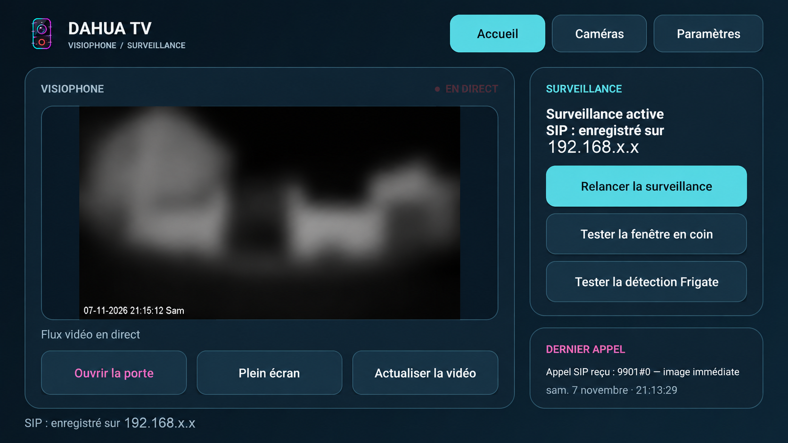
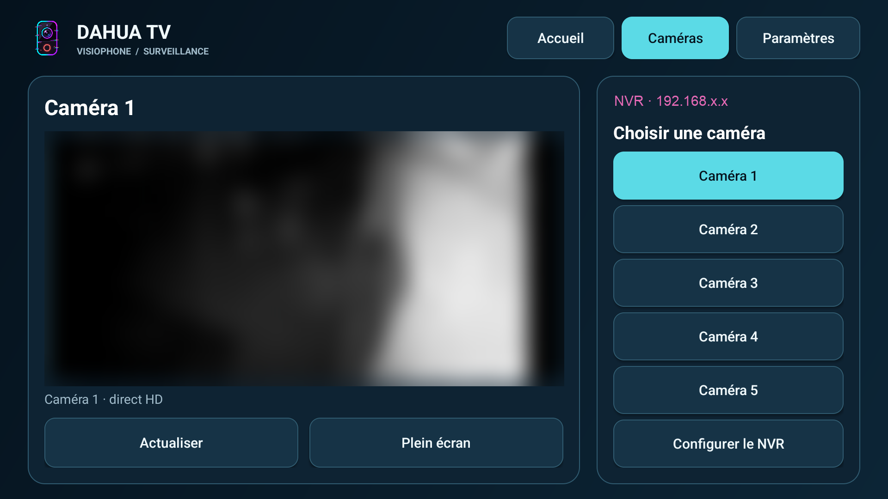
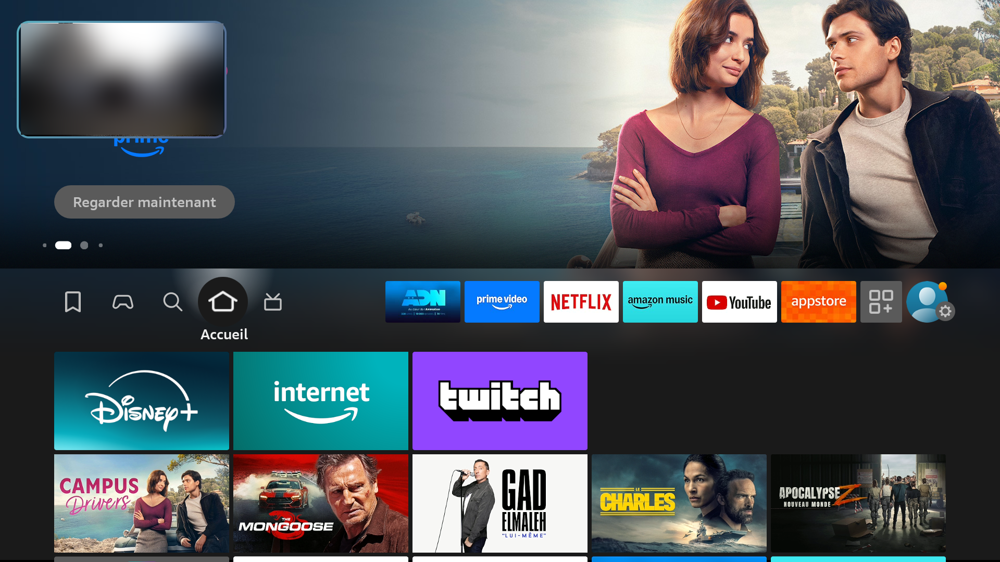
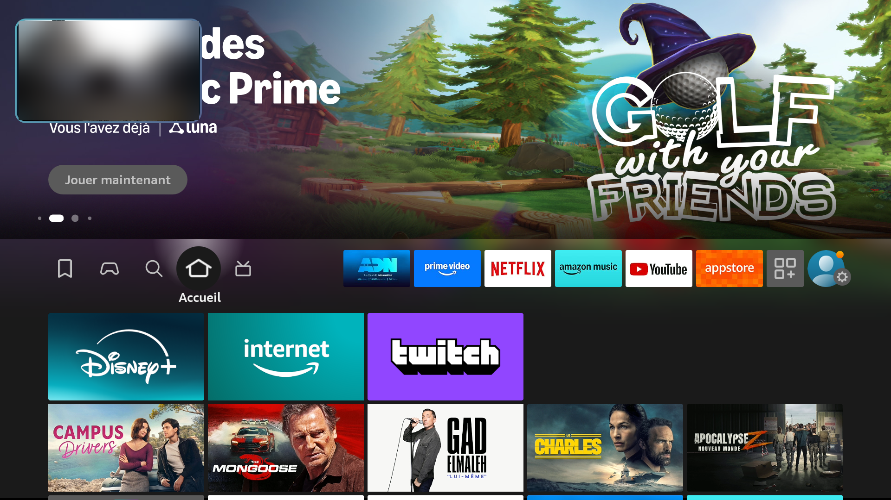

<p align="center"></p>

# Dahua TV

**Le visiophone et les caméras Dahua sur votre télévision.** Dahua TV reçoit les appels du visiophone, affiche sa vidéo dans une fenêtre sur l'écran et permet de consulter les caméras du NVR à la télécommande. L'application fonctionne sur le réseau local, sans service cloud obligatoire.

[Installer avec Downloader](#installer-avec-downloader-sur-android-tv-et-fire-tv-stick) · [Télécharger le dernier APK](https://github.com/crashcool69/Dahua-TV/releases/latest/download/DahuaTV.apk) · [Lire le guide d'installation](INSTALLATION.md) · [Voir la compatibilité](COMPATIBILITE.md)

## Découvrir l'application

L'accueil réunit le direct du visiophone, l'état de la surveillance SIP et les commandes principales. Lorsqu'un appel arrive, une petite fenêtre vidéo peut apparaître au-dessus de l'écran en cours, à condition que l'appareil autorise l'affichage par-dessus les autres applications.



L'onglet **Caméras** ouvre les flux du NVR. Vous pouvez choisir une caméra ou utiliser la grille de quatre caméras. Le NVR et cette grille ont été confirmés sur le Fire TV Stick testé, ainsi que sur la télévision TCL testée.



Sur le Fire TV Stick testé, la fenêtre d'appel reste visible au-dessus de l'accueil Amazon. La partie filmée par le visiophone est floutée sur cette capture réelle.



Les réglages couvrent le compte SIP du visiophone, le flux RTSP, les identifiants vidéo, la fenêtre d'appel et les canaux du NVR. Un bouton permet aussi de tester l'affichage de la fenêtre. Les données de votre installation se saisissent **sur votre appareil** : aucune adresse, aucun identifiant et aucun mot de passe personnel ne sont nécessaires dans ce dépôt.

## Matériel et fonctions

| Fonction | Ce qu'elle permet |
| --- | --- |
| VTO / VTH Dahua | Recevoir le signal d'appel du visiophone via un compte SIP adapté à votre installation. |
| Vidéo RTSP | Voir le direct du visiophone, puis la fenêtre d'appel si la superposition est autorisée. |
| NVR | Consulter les caméras et la grille de quatre flux sur les appareils vérifiés. |
| Frigate | Reprendre les flux RTSP du NVR utilisés dans une installation Frigate ; les éventuelles fonctions de détection dépendent de la version et de la configuration. |
| Télécommande | Parcourir l'accueil, les caméras et les paramètres sans écran tactile. |

## Installer Dahua TV

### Installer avec Downloader sur Android TV et Fire TV Stick

Vous n'avez pas besoin de recopier une longue adresse avec la télécommande. **Downloader**, l'application d'**AFTVnews**, permet de récupérer l'APK de Dahua TV à l'aide d'un code court. Voici sa véritable icône pour la reconnaître dans le magasin d'applications :


[Voir la fiche officielle de Downloader sur Google Play](https://play.google.com/store/apps/details?id=com.esaba.downloader)

| Étape | Sur Android TV ou Fire TV Stick |
| --- | --- |
| 1. Préparer | Sur **Android TV**, cherchez **Downloader** dans le **Play Store**. Sur **Fire TV Stick**, cherchez-le dans l'**Appstore Amazon**. Vérifiez l'icône orange ci-dessus et l'éditeur **AFTVnews**. |
| 2. Autoriser | Sur **Android TV**, ouvrez **Paramètres > Applications > Accès spécial aux applications > Installer des applications inconnues** et autorisez **Downloader**. Sur **Fire TV**, ouvrez **Ma Fire TV > Options pour les développeurs > Installer des applications inconnues** et autorisez **Downloader**. Les noms des menus peuvent varier. |
| 3. Télécharger | Lancez Downloader, saisissez le code ci-dessous dans la zone de recherche et validez avec **Go / Aller**. |
| 4. Installer | Vérifiez que le fichier proposé est **`DahuaTV.apk`** et qu'il vient de ce dépôt GitHub. Une fois téléchargé, choisissez **Installer**, puis **Ouvrir**. |

**Code Downloader pour Dahua TV**

```text
5492774
```

Le téléchargement doit mener à la [dernière version de `DahuaTV.apk`](https://github.com/crashcool69/Dahua-TV/releases/latest/download/DahuaTV.apk). Si le code n'ouvre pas le bon fichier, saisissez cette adresse directement dans Downloader. Au premier lancement, renseignez vos paramètres SIP et RTSP dans Dahua TV, puis testez un appel du visiophone.

La capture ci-dessous montre le résultat **après installation et configuration** sur le Fire TV Stick testé : la fenêtre Dahua TV apparaît au-dessus de l'accueil Fire TV. La vue privée du visiophone est floutée.



Le [tutoriel illustré](INSTALLATION.md) détaille les deux parcours, les menus possibles et la configuration du visiophone et des caméras.

## Compatibilité et limites

Le même APK a été vérifié le 8 novembre 2026 sur une **TCL Smart TV Pro sous Android TV 12** et un **Fire TV Stick AFTSS sous Fire OS 7.6.5.2**. Le NVR et la grille de quatre caméras fonctionnent aussi sur ce Fire Stick. Une TV ou un stick doit pouvoir installer des APK Android TV ; un appareil sous Vega OS ne peut pas exécuter cet APK. La fenêtre au-dessus des autres applications dépend des autorisations et du système de l'appareil.

Un visiophone peut limiter le nombre d'enregistrements SIP ou de sessions vidéo simultanés. Si la TV et le stick utilisent le même compte et le même flux, désactivez la surveillance continue sur l'un des deux si les appels ou l'image deviennent instables. La réception audio et la possibilité de parler au visiteur dépendent du flux, du matériel et de la version ; ne comptez pas sur une interphonie bidirectionnelle sans l'avoir testée sur votre installation. Consultez [les essais et limites connus](COMPATIBILITE.md).

Les captures ci-dessus proviennent de l'application réelle. Les zones privées y sont floutées ; aucune interface n'a été recréée pour cette page.
